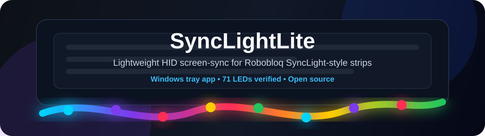

<p align="center">
  
</p>

<h1 align="center">SyncLightLite</h1>

<p align="center">Developed by <a href="https://github.com/Tanoooki">Tanoooki</a></p>

<p align="center">
  Lightweight, open-source Windows HID ambient-light/screen-sync controller for Robobloq SyncLight-style monitor backlight strips.
</p>

<p align="center">
  <a href="https://github.com/Tanoooki/SyncLightLite/releases/latest"></a>
  <a href="LICENSE"></a>
  
  
</p>

> [!IMPORTANT]
> Close the original SyncLight application before using SyncLightLite. Both apps try to open the same USB HID interface, and running them together is the most likely cause of “it does not work”.

SyncLightLite replaces the heavier vendor desktop app with a small Node.js live engine plus a native Windows tray/settings app. The current 1.0.3 release was built and verified against a Robobloq/SyncLight HID light strip with 71 LEDs.

## Download

👉 Download the latest prebuilt Windows release here:

https://github.com/Tanoooki/SyncLightLite/releases/latest

For 1.0.3, download:

`SyncLightLite-1.0.3-windows-x64.zip`

Then extract it and run `SyncLightLiteSetup.exe`.

## Why?

The official SyncLight application can consume a surprisingly large amount of RAM and CPU for a simple ambient lighting controller. SyncLightLite was created to provide a lightweight, open-source alternative while preserving the original everyday experience: start with Windows, stay in the tray, expose practical tuning controls and turn the lights off cleanly.

This project started as a very specific fix for one PC and one light strip. It became a reusable, documented app so other people with the same hardware can avoid repeating the reverse-engineering work.

## Highlights

- Real-time screen-edge color sync for a 71-LED monitor backlight strip.
- Native Windows tray app with single-instance behavior.
- Dark/noir settings UI inspired by VS Code.
- Start Menu shortcuts and optional autostart with Windows.
- Safe tray controls: start sync, stop and turn off LEDs, turn off LEDs now, open logs.
- Practical tuning controls:
  - FPS: 15-120
  - capture scale and top/header offset
  - horizontal margin
  - brightness, saturation, gamma
  - black floor, smoothing and change threshold
- Focused automated tests for packet layout, mapping, config, UI wiring and packaging.

## SyncLightLite vs original SyncLight app

A controlled local benchmark showed the following on the development machine:

| App | Processes | Working set RAM | Private memory | CPU in benchmark window |
| --- | ---: | ---: | ---: | ---: |
| SyncLightLite | 2 | ~101 MB | ~32 MB | ~2.25% total machine |
| Original SyncLight | 5 | ~462 MB | ~302 MB | ~4.08% total machine |
| Approximate reduction | -3 | ~78% less | ~89% less | ~45% less |

These numbers are machine/workload dependent. Reproduce locally with:

```powershell
powershell -ExecutionPolicy Bypass -File tools\benchmark-vs-traditional.ps1
```

## Compatibility

### Confirmed hardware

| Device family | USB HID VID/PID | Interface | LED count | Status | Notes |
| --- | --- | ---: | ---: | --- | --- |
| Robobloq SyncLight / SyncLightLite-style monitor strip | `1A86:FE07` | `0` | 71 | Confirmed | Tested on Windows with the cable-side LED as logical LED 1. |

### Expected but unverified

Other Robobloq/QuikLight/SyncLight products may work if they expose the same HID protocol and compatible LED ordering, but they are not claimed as supported until someone tests them.

If you test another model, please open an issue with:

- brand/model and photos if possible
- VID/PID/interface from `node-hid`
- LED count
- whether `info`, `solid red/green/blue`, `range 1 5 white` and `live` worked
- physical location of logical LED 1

### Operating system

- Windows 10/11 x64 is the supported target for 1.0.
- The tray app is .NET 9 Windows Forms.
- The live engine is Node.js and uses native HID/screen-capture dependencies.
- Linux/macOS are not supported by the packaged tray product.

## Install from release

1. Download `SyncLightLite-1.0.3-windows-x64.zip` from the GitHub release.
2. Extract the zip.
3. Run `SyncLightLiteSetup.exe`.
4. Open SyncLightLite from the Start Menu, or let it start automatically after login.

The installer is per-user and installs under:

`%LOCALAPPDATA%\Programs\SyncLightLite`

It also creates:

- Start Menu shortcut: SyncLightLite
- Start Menu folder: SyncLightLite
- Startup shortcut for autostart, pointing directly to `SyncLightLite.exe` so Task Manager shows the app name/icon instead of a `.cmd` launcher
- Shutdown/logoff handling inside the tray app to turn off the LEDs before Windows closes the Node live engine
- Windows “Installed Apps” entry with icon, version and uninstall command
- First-run language selection based on Windows UI language when possible. Supported UI languages: English, Brazilian Portuguese, Spanish and Chinese. Unsupported languages fall back to English.

To uninstall, use Windows Settings -> Apps -> Installed Apps -> SyncLightLite -> Uninstall. The installed uninstaller is an `.exe`, not a `.cmd` or `.ps1` script.

The settings UI uses compact tabs instead of one long scrolling form:

- General: language, profile, LED order inversion and FPS.
- Effects: screen sync, fixed color, breathing, rainbow, color cycle and wave modes.
- Capture: vertical scale, top/header offset and horizontal margin.
- Colors: brightness, saturation, gamma, threshold, black floor and smoothing.

It includes a flag-based language selector: 🇺🇸 English, 🇧🇷 Português, 🇪🇸 Español and 🇨🇳 中文. Changing the language updates the visible settings UI immediately; saving also refreshes the tray menu language. Saving settings no longer opens a blocking popup; the save button briefly pulses green and changes to a localized “Saved” label.

## How it works

SyncLightLite has two layers:

1. `src/live.js`: Node.js live engine.
   - Opens the USB HID light strip.
   - Reads device info.
   - In screen-sync mode, captures the primary monitor using the Robobloq/QuikLight native module.
   - Samples the screen edges into LED colors.
   - In effect modes, generates fixed color, breathing, rainbow, color-cycle and wave frames locally.
   - Applies brightness, saturation, gamma, smoothing, black-floor and threshold processing.
   - Sends HID packets continuously at the configured FPS.

2. `tray/SyncLightLite.Tray`: native Windows tray app.
   - Starts/stops the Node live engine.
   - Provides the settings UI.
   - Saves `config.json` and restarts sync when settings are applied.
   - Handles single-instance behavior and shutdown/off paths.

### HID protocol notes

Observed packets use two related packet headers:

- `RB` packets for device info/open/solid section commands.
- `SC` packets for per-LED screen-sync data.

For the 71-LED device, full `SC` packets are larger than a single 64-byte HID report, so SyncLightLite splits writes into 64-byte chunks and prefixes each write with report ID `0`.

Observed mapping for the confirmed strip:

- Logical LED 1 starts at the USB cable side.
- Logical order advances away from the cable toward the physical end of the strip.
- Screen mapping currently follows the observed monitor layout: right side -> top right-to-left -> left side.

## Build/run from source

### Requirements

- Windows 10/11 x64
- Node.js 22+ recommended
- .NET SDK 9.x
- A compatible HID light strip

### Important dependency note

Due to licensing/distribution restrictions, one native dependency cannot currently be obtained directly from npm. The prebuilt GitHub releases include all required runtime components, but building from source requires access to a compatible local copy.

More specifically, the screen-capture module used by the vendor ecosystem, `@warren-robobloq/quiklight`, is not currently available from the public npm registry. Source checkouts may need a vendored `vendor/node_modules` folder or `SYNCLIGHTLITE_NODE_MODULES` pointing to a compatible local dependency folder.

### Commands

```bat
npm test
npm run package:release
```

Useful direct commands:

```bat
node src\live.js info
node src\live.js solid red
node src\live.js solid green
node src\live.js solid blue
node src\live.js range 1 5 white
node src\live.js off
node src\live.js live --fps 30
node src\live.js live --reverse-led-order
```

Close the vendor SyncLight app before running SyncLightLite, otherwise both apps may contend for the same HID interface.

## Configuration

`config.json` stores the live tuning values. The tray UI edits the same file.

```json
{
  "fps": 30,
  "captureScalePercent": 90,
  "headerOffsetPercent": 23,
  "horizontalMarginPercent": 10,
  "brightnessPercent": 130,
  "saturationPercent": 100,
  "gamma": 0.9,
  "thresholdPercent": 0,
  "blackFloorPercent": 25,
  "smoothing": 0.15,
  "reverseLedOrder": false
}
```

Practical meanings:

- `fps`: target update rate. Higher is smoother but uses more CPU/USB bandwidth.
- `captureScalePercent`: vertical percentage of screen sampled for ambient colors.
- `headerOffsetPercent`: ignores top UI/header area before sampling.
- `horizontalMarginPercent`: avoids sampling the extreme left/right edge.
- `brightnessPercent`: final LED brightness multiplier.
- `saturationPercent`: color intensity multiplier.
- `gamma`: brightness curve; lower brightens mid-tones, higher adds contrast/darkness.
- `thresholdPercent`: minimum average color change before sending another packet.
- `blackFloorPercent`: values below this brightness become black.
- `smoothing`: blend factor between old and new colors.
- `reverseLedOrder`: reverses the physical LED order for strips installed in the opposite direction. Enable this if the colors appear mirrored left/right or the cable starts on the opposite side.

## FAQ

### Does it work with every SyncLight?

No. Only one device family has been fully verified so far: `1A86:FE07`, interface `0`, 71 LEDs.

### Can I brick my LEDs?

There are no known cases from this project. SyncLightLite sends reversible lighting commands, and `node src\live.js off` or tray “Parar e apagar luz” are the safe off paths.

### Does it replace the original software?

Yes, for the confirmed hardware. It is meant to run instead of the original app, not alongside it.

### Can both apps run together?

No. Close the original SyncLight app before using SyncLightLite to avoid HID contention.

### Why is source setup different from the release zip?

The release zip bundles the runtime components needed by the packaged app. Building from source requires access to a compatible local copy of one native dependency that is not currently distributed through npm.

### Can I add support for another device?

Yes. Open an issue or pull request with VID/PID/interface, LED count, basic color test results and physical LED ordering.

## Project layout

```text
src/                         Node HID/live engine
tray/SyncLightLite.Tray/     Windows tray/settings app
scripts/                     helper/startup scripts and release packager
assets/                      icon/banner assets
tests/                       focused Node tests
tools/                       benchmark tooling
calibration/                 visual calibration helper
```

## Limitations

- 1.0 is Windows-only.
- Hardware support is intentionally conservative: only `VID 1A86 / PID FE07 / interface 0` is enabled in code.
- The bundled release depends on native binaries, so portability across Node/Windows architectures is limited to the packaged target.
- Multi-monitor capture currently uses the primary monitor.

## Roadmap

- [x] Windows support
- [x] Tray application
- [x] Installer package
- [ ] Multiple monitor support
- [ ] Additional HID devices
- [ ] Plugin mapping profiles
- [ ] More screenshots/GIFs in the README

## Safety

SyncLightLite writes directly to a USB HID lighting device. Commands are reversible, and `node src\live.js off` / tray “Parar e apagar luz” are the safe off paths. Avoid running the vendor app and SyncLightLite at the same time.

## Contributing

Contributions are welcome, especially:

- reports for additional compatible devices
- safer protocol documentation
- improved LED mapping profiles
- installer improvements
- CI that can validate more of the Windows packaging path

Please keep device-specific claims backed by real hardware verification.

## License

MIT. See `LICENSE`.
